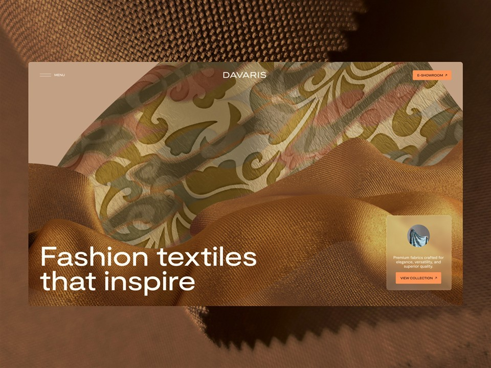
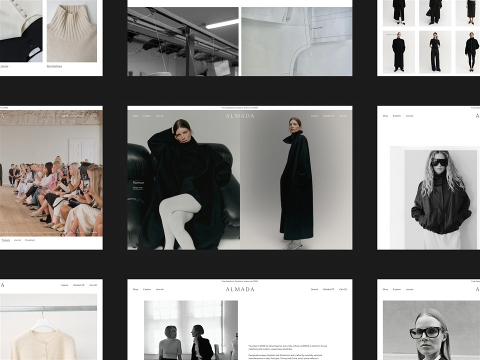
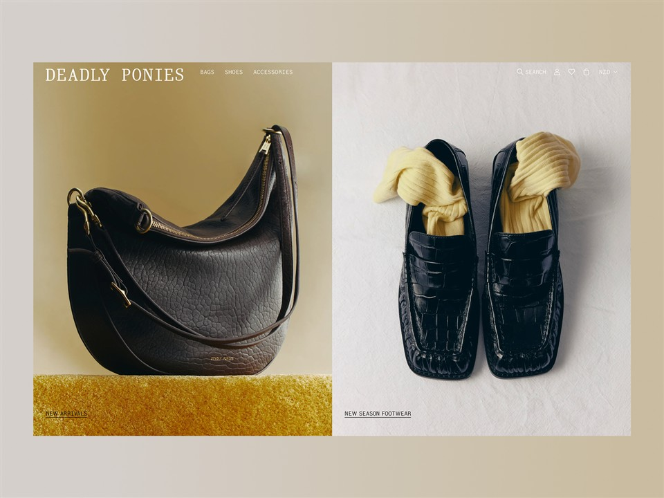
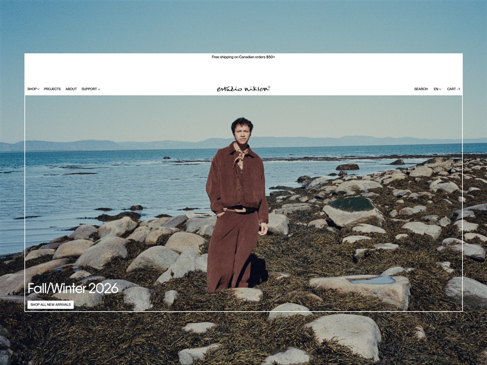
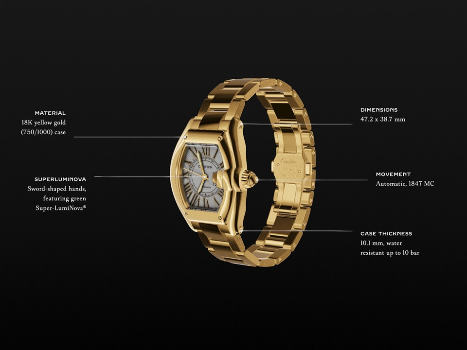
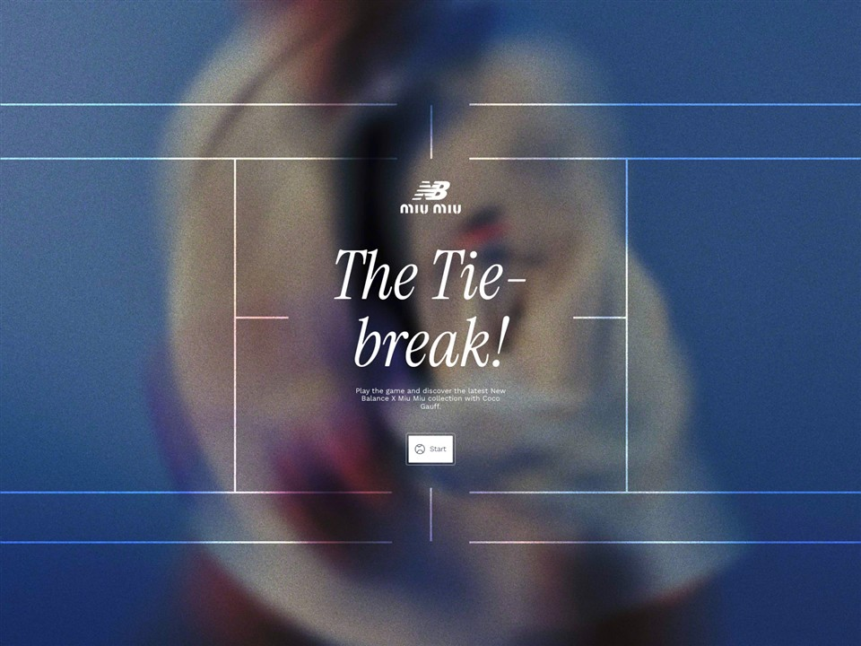

# Six references for Lynette’s Dhara Collection

The brief’s thread motif can do three jobs across the site. It can follow the sweep of the drape, divide one range from the next, and guide the eye to the edge of a fabric close-up. The following references informed those decisions. The images are reduced copies of official Awwwards submission previews, included for design research. Each proposed interaction below is an adaptation for Lynette’s boutique.

## Davaris Textiles · Honorable Mention

A close crop makes two things legible at once. The weave catches light in the foreground, while the fabric folds reveal the scale of the pattern behind it. Awwwards also identifies 3D fabric motion as part of this project. For Lynette’s hero, use a gentle cursor-driven bend to reveal one edge of the drape. Keep the name fixed so visitors can read it independently of the motion. [Awwwards entry](https://www.awwwards.com/sites/davaris-textiles) · [Original submission image](https://assets.awwwards.com/awards/submissions/2026/08/6a75bfb9517a0675639927.jpg)

## Almada Label · Honorable Mention

The montage moves between a collar seen up close, a full silhouette and a compact grid. The wide variation in scale gives the clothing two useful readings, construction and fit. For the quick view, open on the full garment and let the visitor move deliberately into a border detail, with the product name and enquiry action held in place. [Awwwards entry](https://www.awwwards.com/sites/almada-label) · [Original submission image](https://assets.awwwards.com/awards/submissions/2026/10/6ac4ee0d56678377962982.png)

## Deadly Ponies · Honorable Mention

Two equal frames give each product its own silhouette, background colour and breathing room. The shared baseline makes them easy to compare. For the desktop range rail, keep neighbouring pieces visible together and align their captions. On touch screens, leave a slice of the next frame in view to suggest a swipe. [Awwwards entry](https://www.awwwards.com/sites/deadly-ponies) · [Original submission image](https://assets.awwwards.com/awards/submissions/2026/09/6ab9a2adc38ed953556599.png)

## Estudio Niksen · Honorable Mention

The thin frame and low caption allow the viewer to take in both the outfit and its surroundings. For Lynette’s lookbook, preserve the photographer’s composition and keep the current piece’s name at a consistent edge. Let the next photograph move into position while the caption stays readable. [Awwwards entry](https://www.awwwards.com/sites/estudio-niksen) · [Original submission image](https://assets.awwwards.com/awards/submissions/2026/09/6abc1b954a2b2902603167.png)

## The Cartier Roadster · Honorable Mention

Fine rules link each caption to a precise part of the watch. For textile close-ups, use a short line to connect a verified detail to the photographed edge or weave. On a narrow screen, move the detail text beneath the photograph and retain a close crop so visitors can still locate it. [Awwwards entry](https://www.awwwards.com/sites/the-cartier-roadster) · [Original submission image](https://assets.awwwards.com/awards/submissions/2026/09/6ab1b68ba2c4c801835951.jpg)

## The Tie-break · Site of the Day

The court markings establish the subject before the visitor reads the title. A compact italic serif sits between the lines. Adapt that relationship with one fine thread drawing around the boutique name during the intro. Give visitors a skip control, and expose the final wordmark immediately when they prefer reduced motion. [Awwwards entry](https://www.awwwards.com/sites/the-tie-break) · [Original submission image](https://assets.awwwards.com/awards/submissions/2026/07/6a47a79eb4dbe565070348.jpg)
